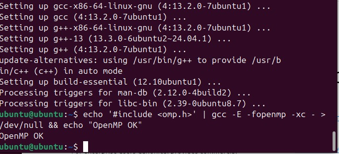
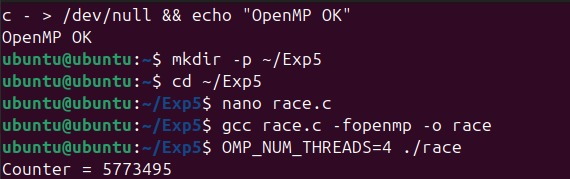
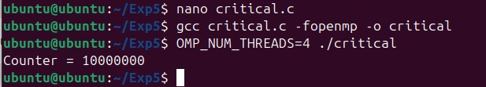
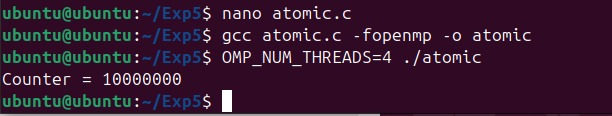
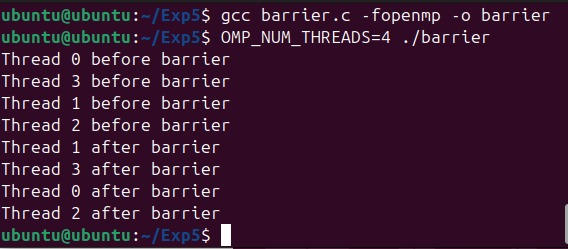
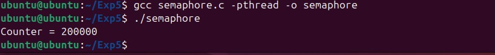
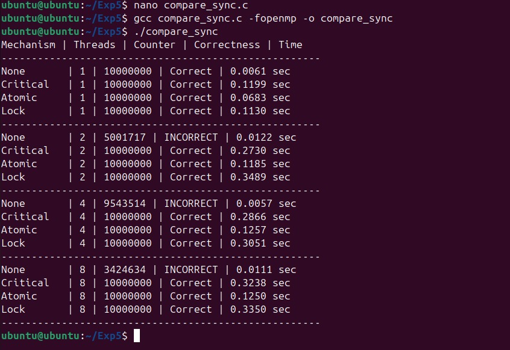

## Screenshots

### 1. OpenMP Program Execution

### 2. Race Condition Output

### 3. Correct Counter Output

### 4. Atomic Operation Output

### 5. Before and After Barrier Messages

### 6. Semaphore Output

### 7. Synchronization Comparison

