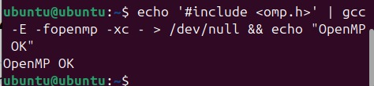
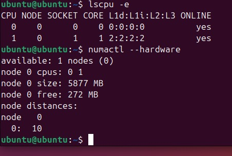
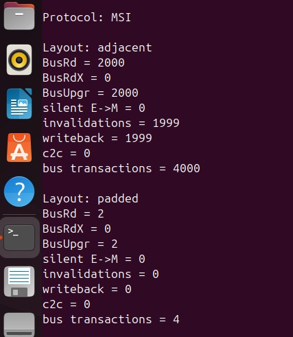
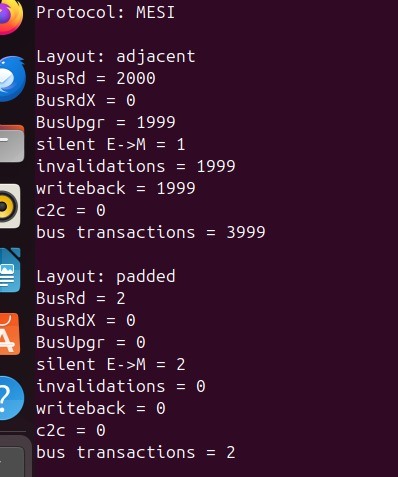
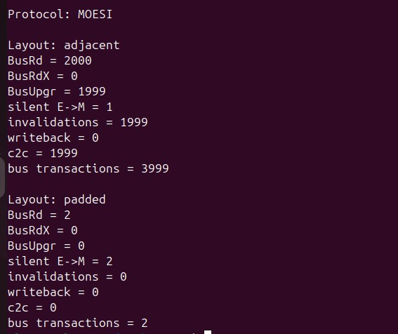
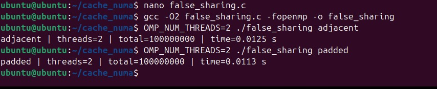
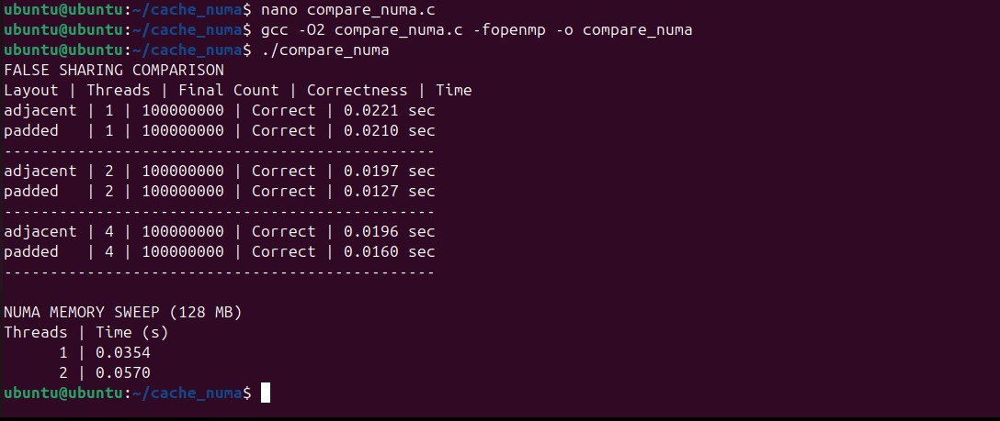
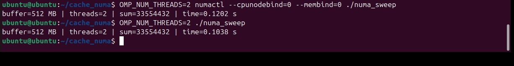

## Screenshots

### 1. Verification of GCC

### 2. Identification of CPU Topology and NUMA Memory Nodes

### 3. MSI Protocol Output

### 4. MESI Protocol Output

### 5. MOESI Protocol Output

### 6. Comparison Between Adjacent and Padded Memory Layouts

### 7. Execution of NUMA Memory Sweep Using Different Thread Counts

### 8. Comparison of False Sharing and NUMA Memory

### 9. Comparison of Local and Remote NUMA Memory Access

